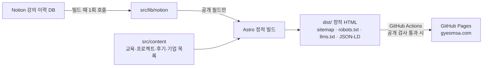

# gyeomsa-web

기업 AX 교육 강사 김윤겸(Yun-gyeom Kim)의 개인 홈페이지 소스입니다. 배포 주소는 [gyeomsa.com](https://gyeomsa.com)입니다.

목표는 두 가지입니다. 이름으로 검색했을 때 이 사이트가 가장 먼저 나오는 것, 그리고 ChatGPT·Perplexity·Gemini·Claude 같은 AI가 이 사람을 설명할 때 이 사이트를 근거로 인용하는 것입니다(SEO·AEO·GEO). 그래서 사람이 보기 좋은 화면만큼 크롤러가 읽기 쉬운 HTML을 요구사항으로 다룹니다.

## 상태

1차 구현을 마쳤고 GitHub Pages로 배포합니다. 요구사항은 [docs/PRD.md](docs/PRD.md), 검색·AI 노출 규칙은 [docs/SEO-GUIDE.md](docs/SEO-GUIDE.md)에 있습니다.

## 구조



- **Notion을 CMS로 씁니다.** 강의 이력은 Notion에서 관리하고, 빌드 시점에만 Notion API로 읽습니다. 방문자의 브라우저는 Notion을 호출하지 않습니다.
- **본문은 모두 정적 HTML에 들어 있습니다.** JavaScript가 꺼져 있어도 모든 내용이 보입니다. 숫자가 올라가는 효과 같은 동적 효과는 이미 그려진 HTML 위에만 얹습니다.
- **나머지 콘텐츠는 저장소의 마크다운·YAML 파일입니다.** 제공 교육, 프로젝트 경험, 고객 후기, 주요 교육 기업 목록, 소개 페이지의 경력·학력·자격이 `src/content/`에 있고, 홈 카드·llms.txt 같은 산출물은 모두 이 파일들에서 만듭니다.
- **AI 크롤러를 위한 산출물을 함께 만듭니다.** 페이지마다 title·description·canonical·OG 태그를 넣고, JSON-LD(Person, ProfilePage, WebSite, BreadcrumbList), sitemap, robots.txt, llms.txt를 빌드 때 생성합니다.

## 공개 저장소에서 개인정보를 지키는 방법

강의 이력에는 공개하면 안 되는 고객사 정보가 섞여 있습니다. 이 저장소는 공개되므로 다음 원칙으로 설계했습니다.

- **공개 여부는 데이터에서 정합니다.** Notion DB에 공개용 필드(공개 과정명, 공개 기업명)를 따로 두고, 두 값이 채워진 항목만 빌드에 들어갑니다. 익명 처리를 코드 규칙으로 하지 않아서, 예외가 생겨도 코드를 고칠 필요가 없습니다.
- **내부 필드는 한 폴더 밖으로 나가지 않습니다.** Notion 호출과 필터는 `src/lib/notion/`에만 두고, 페이지와 컴포넌트는 공개 필드만 받습니다.
- **사이트에 나가지 않는 정보는 저장소에도 두지 않습니다.** 실명과 익명 표기의 대응표는 Notion에만 있고, Notion 응답은 파일로 저장하지 않습니다.
- **커밋 직전에 자동으로 검사합니다.** [.githooks/pre-commit](.githooks/pre-commit)이 비밀값 파일, Notion 토큰 형식, `.env`의 실제 값, 비공개 단어 목록을 검사해 걸리면 커밋을 멈춥니다.
- **배포 직전에 한 번 더 검사합니다.** 배포 워크플로가 빌드 결과를 Notion 내부 값과 대조하고(`npm run check:dist`), 걸리면 배포하지 않습니다. 공개 저장소라 워크플로 로그도 공개되므로, 빌드 로그에는 공개 값만 찍습니다.

## AI 에이전트와 함께 작업하는 방식

이 저장소는 Claude Code와 함께 만듭니다. 에이전트가 세션마다 같은 판단을 하도록 규칙을 파일로 고정했습니다.

| 파일 | 역할 |
| --- | --- |
| [CLAUDE.md](CLAUDE.md) | 작업 규칙. 코딩 규칙, 공개 저장소 규칙, 커밋 메시지 형식, 금지사항 |
| [docs/PRD.md](docs/PRD.md) | 무엇을 왜 만드는지. 범위, 완료 기준, 미정 사항 |
| [docs/SEO-GUIDE.md](docs/SEO-GUIDE.md) | 메타 태그, 구조화 데이터, URL, llms.txt 규칙 |
| [docs/HUMAN-GUIDE.md](docs/HUMAN-GUIDE.md) | 사람이 읽는 운영 설명서 |

에이전트는 문서에 없는 결정을 임의로 하지 않고 묻도록 되어 있습니다. 결정이 나면 코드보다 문서를 먼저 고칩니다.

## 기술 스택

- [Astro](https://astro.build/) 7 정적 출력 + TypeScript(strict), `@astrojs/sitemap`
- Notion API(`@notionhq/client`), 빌드 시점에만 호출
- 순수 CSS(Astro scoped style). 외부 CSS 프레임워크와 분석·추적 스크립트는 쓰지 않습니다
- 글꼴: [Pretendard](https://github.com/orioncactus/pretendard) 1.3.9 공식 서브셋 woff2를 저장소에 두고 직접 내려줍니다(SIL OFL 1.1, `src/assets/fonts/pretendard/LICENSE.txt`)
- 패키지 매니저 npm

## 시작하기

```bash
git config core.hooksPath .githooks   # 커밋 검사 연결(복제 후 한 번)
cp .env.example .env                  # Notion 토큰과 DB ID 입력
npm install
npm run dev       # 개발 서버
npm run build     # Notion에서 내용을 가져와 dist/ 생성
npm run preview   # 빌드 결과 확인
npm run check:dist  # dist/에 Notion 내부 값·토큰이 없는지 검사
```

## 배포

[.github/workflows/deploy.yml](.github/workflows/deploy.yml)이 GitHub Pages로 배포합니다.

- `main`에 push하면 빌드 → 공개 검사(`check:dist`) → 배포 순서로 진행합니다.
- Notion만 고친 날을 위해 매일 04:17(한국 시간)에 다시 빌드합니다. 바로 반영하려면 Actions 탭의 Deploy에서 Run workflow를 누릅니다.
- Notion 토큰과 DB ID는 저장소 Secrets(`NOTION_TOKEN`, `NOTION_LECTURES_DATABASE_ID`)에만 둡니다.
- 주소 기준은 `https://gyeomsa.com/`이고, `www`는 GitHub Pages가 이 주소로 리디렉션합니다.

## 폴더

```
docs/            기획·가이드 문서
src/content/     교육·프로젝트·후기·기업 목록·경력 원본
src/assets/      프로필 사진, 글꼴(Pretendard)
src/lib/notion/  Notion 호출과 공개 필드 필터
src/pages/       라우트(홈·소개·강의 이력·문의, llms.txt·robots.txt)
scripts/         빌드 결과 공개 검사
.githooks/       커밋 직전 검사
.github/workflows/  배포(GitHub Pages)
```
